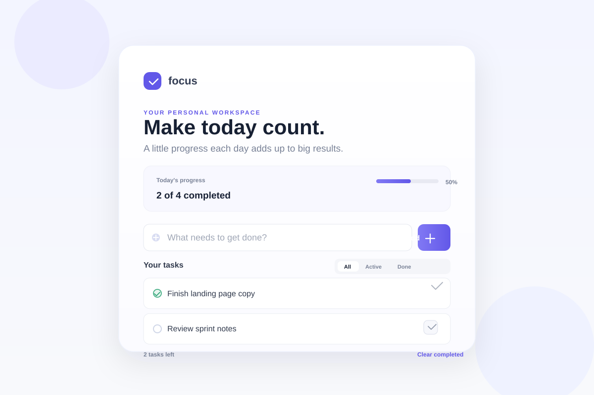

# ✅ basic-todo

A clean, fast, and distraction-free to-do app built with HTML, CSS, and JavaScript.

  

## 🖼️ Preview

A focused task manager with a modern dashboard layout, progress tracking, filters, and local persistence.

## ✨ Features
- Add new tasks instantly
- Mark tasks as complete or active
- Delete individual tasks
- Filter by All, Active, and Done
- Clear completed tasks in one click
- Save tasks locally with `localStorage`
- Responsive layout for smaller screens

## 🚀 How to use
1. Open `index.html` in your browser.
2. Type a task in the input box.
3. Click "Add task" to save it.
4. Mark tasks complete, filter them, or remove them as needed.

## 🛠️ Tech Stack
- HTML
- CSS
- JavaScript

## 📌 Project Info
Project name: `basic-todo`

This app is designed to keep task management simple, clear, and visually pleasant.